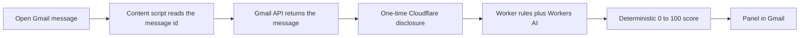

# PhishLens

Know the risk before you click.

PhishLens is a Chrome extension that scores the Gmail message you have open. The page is only used to see which message is open and to draw the panel. The message itself comes from the Gmail API. After one disclosure, that message is sent to a Cloudflare Worker, where rules and Workers AI produce a 0–100 score.

## Flow



Turn Cloudflare AI off and the same message stays on the device. The panel then shows the local heuristic and says that result is less accurate.

## Install the extension

1. Open `chrome://extensions`.
2. Turn on Developer Mode.
3. Choose Load Unpacked.
4. Select the `extension` directory in this repo.
5. Reload the extension after each update, then open Gmail and open one message.
6. Allow the Gmail prompt. Accept the Cloudflare disclosure once. Until a Worker URL is set in `extension/config.js`, the panel shows the local heuristic and says so.

## Deploy the Worker

From `worker/`, after `npx wrangler login`:

```bash
npx wrangler deploy
```

Paste the printed `*.workers.dev` URL into `PHISHLENS_WORKER_URL` in `extension/config.js`, reload the extension, and open a message again. The deployed Worker is `https://phishlens.phishlens.workers.dev`.

Open another message and the panel follows that message. Expand more than one message in a thread and PhishLens will not guess.

The extension id is pinned with the public key in `extension/manifest.json`, so it stays stable across reloads:

`lcfopfbcjkdkoaamdokiklgljmoanpib`

That id will be used later for Gmail OAuth.
